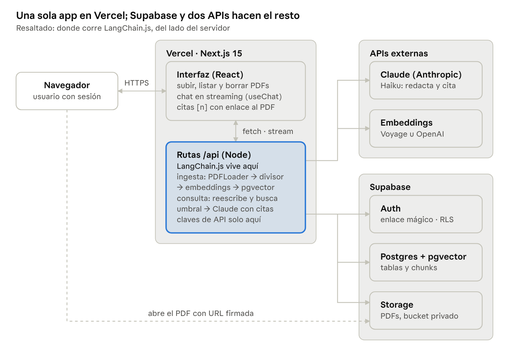
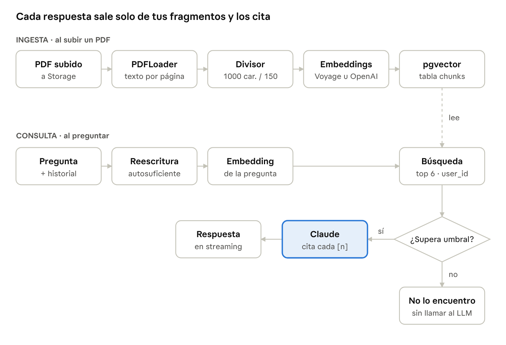

# Plan técnico · Asistente RAG sobre documentos

Una app Next.js en Vercel con Supabase para todo lo demás (base de datos, vectores, archivos y sesión); LangChain.js arma la ingesta y la consulta.

El navegador solo habla con Next.js; las rutas `/api` son las únicas que tocan Supabase y OpenRouter (LLM y embeddings, con una sola clave `OPENROUTER_API_KEY`). La excepción es abrir un PDF, que va directo a Storage con una URL firmada.

La ingesta llena pgvector una vez por PDF; cada pregunta lee de ahí y, si nada supera el umbral, responde sin llamar al LLM para redactar.

| Pieza | Elección | Por qué |
|---|---|---|
| App | Next.js 16 (App Router, TypeScript estricto), rutas `/api` con `runtime = "nodejs"` | Front y API en un solo proyecto; el lector de PDF necesita Node |
| Orquestación | LangChain.js (`@langchain/community`, `@langchain/textsplitters`) solo para leer y dividir PDFs | Cargador de PDF y divisor de texto listos; el LLM se llama directo con `lib/llm.ts` |
| Proveedor de modelos | OpenRouter (API compatible con OpenAI, `baseURL: https://openrouter.ai/api/v1`) | Una sola clave y una sola factura; permite cambiar de modelo sin tocar código |
| LLM | `deepseek/deepseek-v4-flash` vía el SDK oficial `@openrouter/sdk`, envuelto en `lib/llm.ts` (`complete` y `streamChat`). El slug va en la variable `LLM_MODEL` | Rápido y barato para la demo; se cambia de modelo sin tocar código |
| Embeddings | Locales en el servidor con Transformers.js (`@huggingface/transformers`), modelo `Xenova/multilingual-e5-small` (384 dimensiones, multilingüe); prefijos `query: ` y `passage: ` que exige el modelo | Gratis y sin cuota; funciona en español |
| Datos y vectores | Supabase Postgres + pgvector, búsqueda con la función SQL propia `rag_match_chunks` | Una sola base para filas y vectores; filtra por usuario y documentos |
| Archivos | Supabase Storage, bucket privado | URLs firmadas para abrir el PDF |
| Sesión | Supabase Auth (correo con enlace mágico) | Viene con la base; RLS por usuario |
| UI del chat | Vercel AI SDK (`useChat`); la ruta convierte `streamChat` en un stream de mensaje del AI SDK | Streaming sin código propio en el cliente |

## Ingesta (al subir un PDF)

`POST /api/documents` valida, guarda y responde `201` con estado `processing`; el resto corre después de responder con `after()` de Next.js, dentro de la misma función (sin colas).

1. Validar tipo, tamaño (≤ 10 MB) y que el usuario tenga menos de 20 documentos.
2. Guardar el archivo en Storage y la fila en `rag_documents` con estado `processing`; responder `201`.
3. `PDFLoader` lee el texto página por página y conserva el número de página en los metadatos. Si el PDF tiene más de 50 páginas, marcar `error` con el motivo y parar.
4. `RecursiveCharacterTextSplitter` corta en fragmentos de unos 1000 caracteres con 150 de solapamiento.
5. Calcular los embeddings por lotes y guardarlos en `rag_chunks`.
6. Marcar el documento `ready`, o `no_text` si no salió texto. Ante cualquier fallo, `error` con el motivo en `rag_documents.error`.

La lista de documentos consulta `GET /api/documents` cada 2 s mientras haya alguno en `processing`, para pasar a "Listo" sin recargar.

## Consulta (al preguntar)

1. Si hay historial, reescribir la pregunta como una pregunta completa con el LLM (cadena *history-aware*). Sin historial, se usa tal cual y se ahorra esa llamada.
2. Buscar con `rag_match_chunks` los 6 fragmentos más parecidos, filtrando por `user_id` y por los documentos marcados en la conversación.
3. Si ninguno supera el umbral de similitud, responder "No lo encuentro en tus documentos" sin llamar al LLM para redactar.
4. Si no, enviar al LLM los fragmentos numerados [1]…[6] con estas reglas: citar cada afirmación con [n], no usar nada fuera de los fragmentos, responder en el idioma de la pregunta y, si los fragmentos no contienen la respuesta, decir que no la encuentra sin citar nada.
5. Transmitir la respuesta y, al final, las citas que de verdad aparecen en el texto (número → documento, página, fragmento). Si no aparece ninguna, la lista va vacía.

## Decisiones

- **Sin agente ni herramientas en v1**: una cadena fija es más predecible y fácil de evaluar.
- **Ingesta con `after()`**, sin colas: alcanza con el límite de 50 páginas por PDF y con el tiempo máximo de una función en Vercel.
- **Umbral de similitud** ajustable en una constante; su valor se fija con el set de evaluación (que existe desde la fase 1).
- **RLS siempre activa**: las rutas `/api` usan el cliente de Supabase con la sesión del usuario, nunca la clave de servicio, para que RLS actúe además de los filtros del código.
- **Citas de documentos borrados**: las citas guardadas apuntan a `document_id` y `chunk_id`; si ya no existen, la UI muestra "Fuente borrada" sin fragmento ni enlace. No se copia el texto del fragmento en `rag_messages`, para que borrar un documento borre de verdad su contenido.
- **Modelos por variables de entorno**: `OPENROUTER_API_KEY`, `LLM_MODEL` y `EMBEDDING_MODEL` solo en el servidor. Cambiar el modelo de embeddings obliga a reingerir todos los documentos y puede cambiar la dimensión del vector.
- **Límites diarios** sin tabla extra: las preguntas del día se cuentan en `rag_messages` (`role = 'user'`) y los documentos en `rag_documents`.

## Modelo de datos

Cuatro tablas en Postgres (`rag_documents`, `rag_chunks`, `rag_conversations`, `rag_messages`), todas con `user_id` y políticas RLS que solo dejan ver las filas propias, más la función de búsqueda `rag_match_chunks`. El SQL completo está en [`supabase/migrations/0001_init.sql`](../supabase/migrations/0001_init.sql); esa migración es la fuente de la verdad del esquema.

- `rag_chunks.embedding` es `vector(384)` (embeddings locales gratuitos con `multilingual-e5-small`); cambiar de modelo obliga a cambiar la dimensión en la tabla y en `rag_match_chunks`, y a reingerir.
- `rag_messages.citations` guarda solo `[{n, document_id, page, chunk_id}]`.
- `rag_match_chunks(query_embedding, doc_ids, match_count)` filtra por `auth.uid()` y por `doc_ids` (vacío = todos) y devuelve la similitud para aplicar el umbral.

Storage: bucket privado `documents` con rutas `{user_id}/{document_id}.pdf` y políticas que solo dejan leer y borrar la carpeta propia.

## API

| Método y ruta | Entrada | Salida |
|---|---|---|
| `POST /api/documents` | `multipart/form-data` con `file` (PDF, ≤ 10 MB) | `201 {id, name, status: "processing"}`; `400`, `413` o `429` con `{error}` |
| `GET /api/documents` | — | `200 [{id, name, pages, status, error, created_at}]` |
| `DELETE /api/documents/:id` | — | `204`; borra archivo, fragmentos y vectores |
| `GET /api/documents/:id/url?page=n` | — | `200 {url}` firmada por 10 min, apunta a `#page=n` |
| `POST /api/conversations` | `{document_ids?}` | `201 {id}` |
| `GET /api/conversations` | — | `200 [{id, title, created_at}]` |
| `GET /api/conversations/:id` | — | `200 {id, title, document_ids, messages[]}` |
| `PATCH /api/conversations/:id` | `{document_ids}` | `200 {id, document_ids}` |
| `POST /api/chat` | `{conversation_id, message}` (enviado desde `useChat` con `prepareSendMessagesRequest`) | Stream de mensaje del AI SDK; las citas `[{n, document, page, snippet}]` van en la metadata del mensaje al terminar |

Errores siempre como `{error: "mensaje en español"}`; `429` cuando se pasa un límite (20 PDFs o 30 preguntas al día).

## Riesgos

- **Pausa de Supabase**: los proyectos gratuitos se pausan tras una semana sin actividad; la demo necesita un ping periódico (cron de Vercel) o aceptar que a veces esté dormida.
- **Tiempo máximo de la función en Vercel**: la ingesta de un PDF de 50 páginas debe caber holgadamente; si no, bajar el límite de páginas antes que añadir colas.

## Preguntas abiertas

- [ ] ¿Los embeddings locales caben en el tiempo y tamaño de una función de Vercel (arranque en frío, descarga del modelo)? Comprobar en T05; si no, pasar a un modelo de embeddings de OpenRouter y cambiar la dimensión.
- [ ] ¿Demo con registro abierto o con un usuario invitado de solo lectura?
- [x] ¿Qué 2 PDFs de ejemplo usar (con licencia que permita publicarlos)? Resuelto en T08: dos PDFs originales y ficticios generados con `npm run eval:pdfs` (`eval/docs/`), sin licencias de terceros.
- [ ] ¿DeepSeek V4 Flash alcanza las metas de evaluación (sobre todo citas y "no inventa") y el primer token en menos de 3 s? Si no, probar otro modelo cambiando `LLM_MODEL`.
